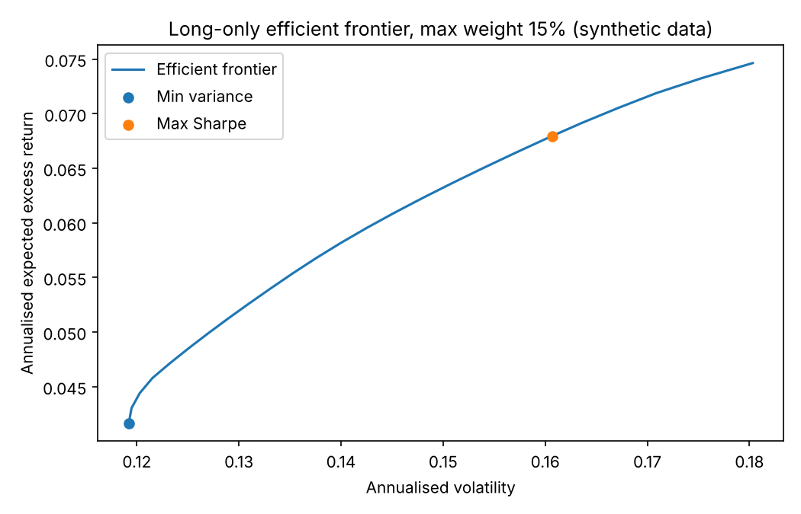
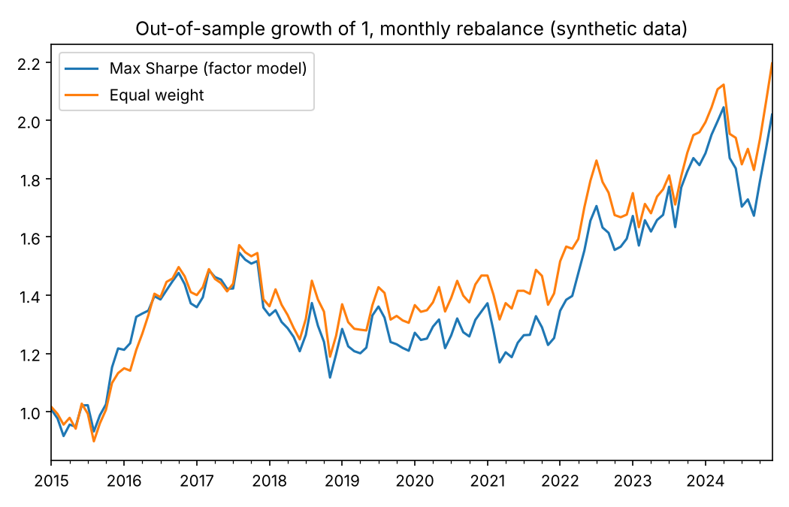

# Factor Model: Risk, Optimisation and Attribution

A from-scratch Python engine that estimates Fama-French factor exposures, builds a factor
risk model, optimises long-only portfolios and tests them out of sample with a walk-forward
backtest. Every step is unit-tested.

Built by a CFA Level II candidate who works as an analytics engineer, to connect portfolio
theory to production-style data code.

## What it does

| Step | Module | What happens |
|---|---|---|
| 1. Data | `data.py` | Monthly prices from Yahoo Finance and Fama-French 3 factors from Kenneth French's library, or synthetic data with known betas for offline runs |
| 2. Exposures | `factors.py` | OLS regression of each stock's excess return on the factors: alpha, betas, R², alpha t-stat |
| 3. Risk model | `riskmodel.py` | Covariance = B F Bᵀ + D, plus a split of portfolio risk into factor and specific parts |
| 4. Optimisation | `optimise.py` | Minimum variance, maximum Sharpe, target return and the efficient frontier, long-only with weight caps (SLSQP with analytic gradients) |
| 5. Backtest | `backtest.py` | Walk-forward: each month refit on the past 60 months only, rebalance, earn next month's return |
| 6. Attribution | `attribution.py` | Splits returns into market, size, value and stock-specific contributions |
| 7. Metrics | `metrics.py` | Annual return, volatility, Sharpe, max drawdown, tracking error, information ratio |

## Results





Out-of-sample backtest, 20 assets, monthly rebalance, 15% weight cap:

| | Max Sharpe (factor model) | Equal weight |
|---|---|---|
| Annual return | 9.9% | 10.8% |
| Annual volatility | 15.8% | 15.3% |
| Sharpe ratio | 0.52 | 0.59 |
| Max drawdown | -25.5% | -22.0% |
| Tracking error vs equal weight | 5.2% | – |

**What this shows:** the optimised portfolio looks best in sample but does not beat equal
weight out of sample. Expected returns estimated from 60 months of history are noisy, and
the optimiser concentrates in the assets whose estimates happen to be highest. This is the
well-known estimation-error problem (DeMiguel, Garlappi and Uppal, 2009), and it is why the
roadmap below adds shrinkage and Black-Litterman.

> The charts and table above come from the synthetic dataset so they can be reproduced
> offline. Run `python run_demo.py --source yahoo` for results on real US stocks.

## The finance behind it

- **Factor regression:** r<sub>i</sub> − r<sub>f</sub> = α<sub>i</sub> + β<sub>i,MKT</sub>·MKT + β<sub>i,SMB</sub>·SMB + β<sub>i,HML</sub>·HML + ε<sub>i</sub>
- **Factor covariance:** Σ = B F Bᵀ + D. With 3 factors the model estimates far fewer
  parameters than a full sample covariance (20 assets need 210), so it is more stable.
- **Expected returns:** μ = B · E[f], the factor-implied premium, rather than raw historical means.
- **Max Sharpe:** maximise (wᵀμ) / √(wᵀΣw) subject to Σw = 1, 0 ≤ w ≤ cap.
- **No look-ahead:** the backtest only uses data available at each rebalance date.

## Run it

```bash
git clone https://github.com/<your-username>/factor-model.git
cd factor-model
pip install -r requirements.txt

python run_demo.py                     # synthetic data, works offline
python run_demo.py --source yahoo      # real prices + Fama-French factors
python run_demo.py --source yahoo --tickers AAPL MSFT JPM XOM JNJ --max-weight 0.3
pytest -q                              # 13 tests
```

## Project structure

```
factor-model/
├── factormodel/
│   ├── data.py          # Yahoo Finance, Fama-French, synthetic data
│   ├── factors.py       # OLS exposures
│   ├── riskmodel.py     # B F B' + D covariance, risk decomposition
│   ├── optimise.py      # min variance, max Sharpe, target return, frontier
│   ├── backtest.py      # walk-forward backtest
│   ├── attribution.py   # factor return attribution
│   └── metrics.py       # performance and risk metrics
├── tests/               # unit tests (pytest)
├── docs/                # generated charts
└── run_demo.py          # end-to-end pipeline
```

## Tests

The tests check things a reviewer would want guaranteed: the regression recovers known
betas on synthetic data, the covariance is symmetric positive definite, risk contributions
add up to total risk, the minimum-variance portfolio beats equal weight on variance, weight
caps hold, attribution sums to the total return, and the backtest never uses future data.

## Roadmap

- Ledoit-Wolf shrinkage for the factor covariance
- Black-Litterman expected returns
- Risk parity and hierarchical risk parity
- Transaction costs and turnover limits
- Fama-French 5 factors plus momentum

## Author

**Jaivansh Dang**, analytics engineer (Power BI, Databricks, Python) and CFA Level II candidate.
[LinkedIn](https://www.linkedin.com/in/jaivansh-dang)
